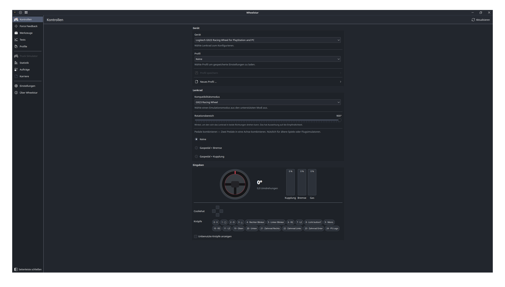
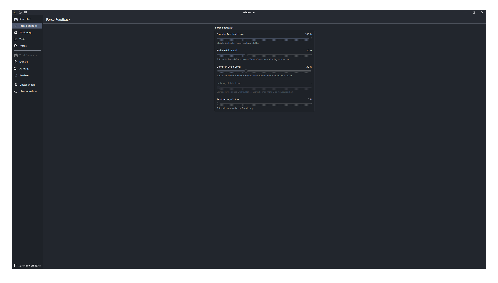
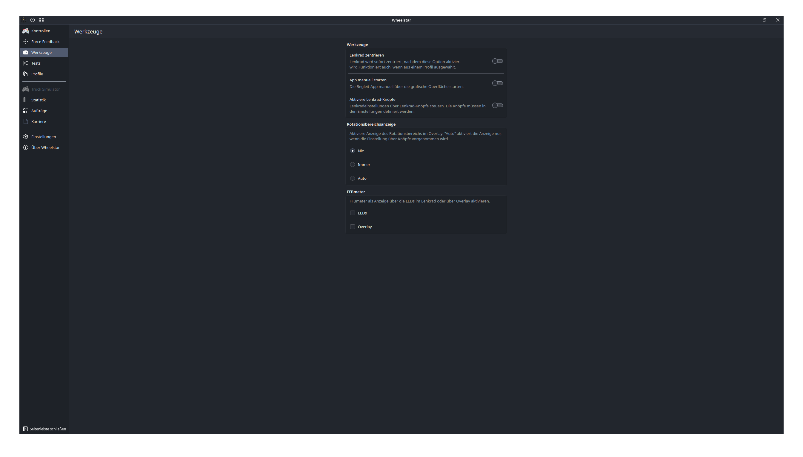
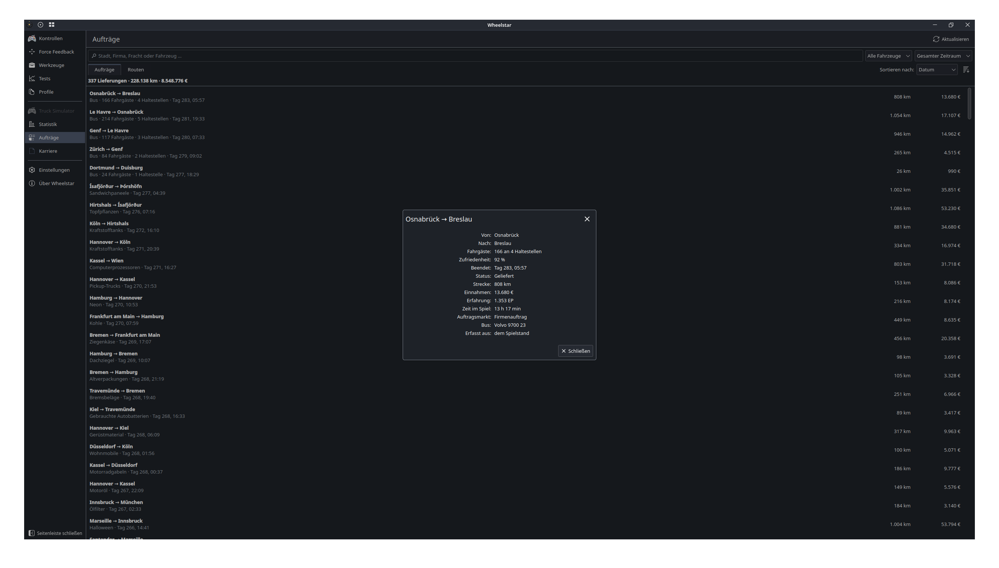
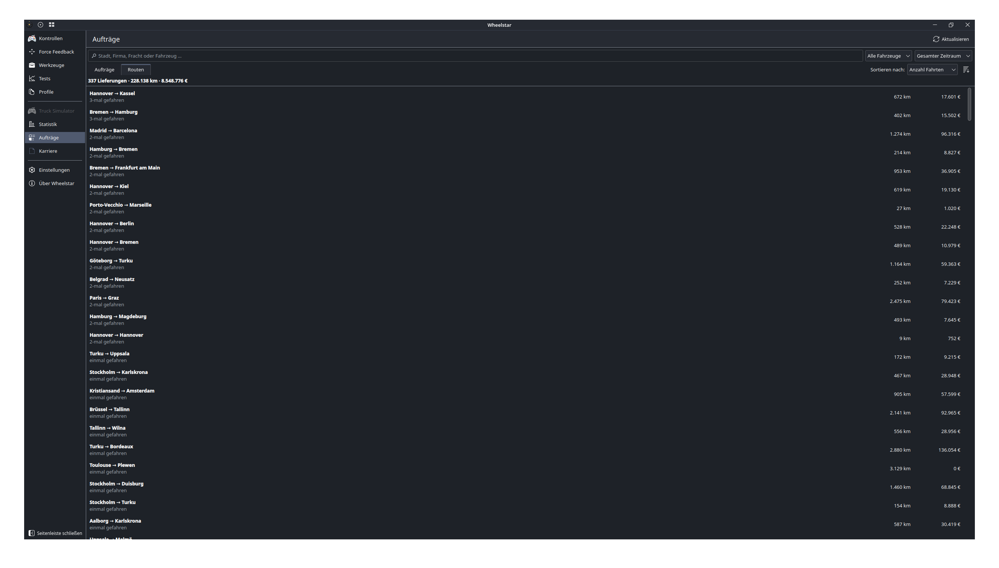
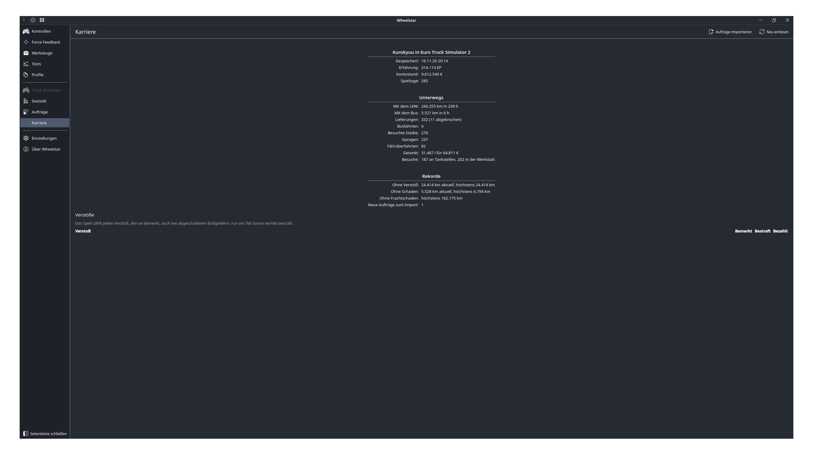
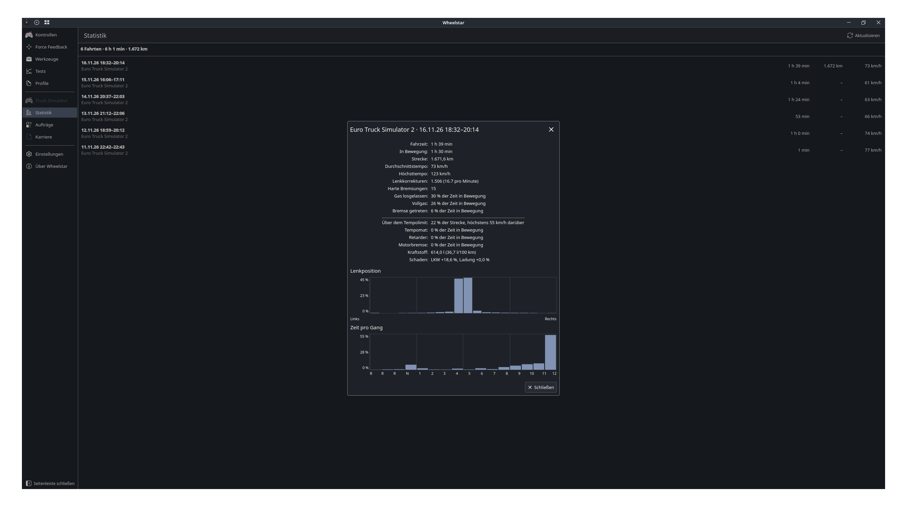
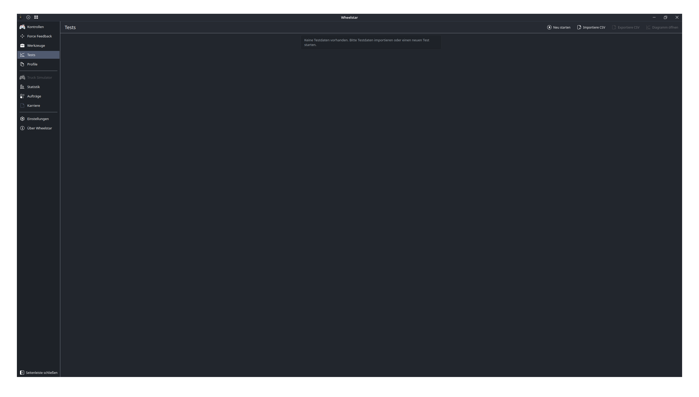
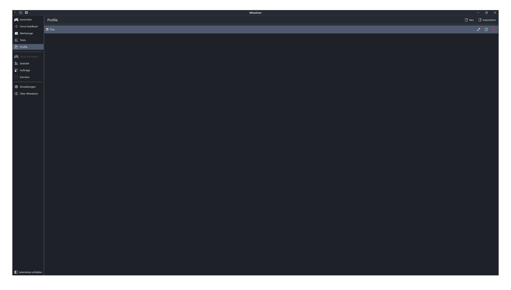
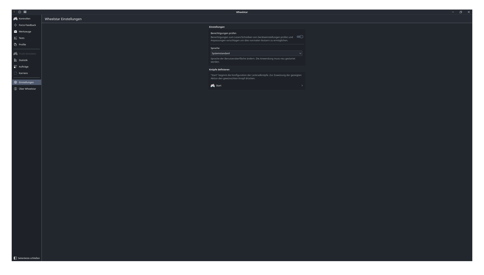

# Wheelstar

A steering wheel manager for Linux with a KDE look: a C++26 / Qt 6 / Kirigami port of
[Oversteer](https://github.com/berarma/oversteer) by Bernat Arlandis. Oversteer is the original and is still
maintained.



## Why a port

Oversteer is a Python/GTK program. Wheelstar was written to fit into a KDE Plasma desktop - Kirigami, Plasma
notifications, the crash handler, one instance per session - and to have room for what Oversteer does not set out
to do: driving statistics, jobs and career for Euro Truck Simulator 2 and American Truck Simulator. It keeps
Oversteer's licence, GPL-3.0-or-later.

## What was taken over, and what was left out

- **Every feature** of Oversteer (list below) and its wheel settings, the three hardware tests and their analysis,
  the profile format (Oversteer's profiles are imported), the udev rule for Logitech wheels and the translations
  (see *Translations*).
- **All Logitech wheels** Oversteer knows, from the Wingman Formula GP to the G PRO.
- **Left out:** the Thrustmaster, Fanatec, Cammus C5, OpenFFBoard and FlashFire 900R entries and their udev rules.
  Wheelstar targets Logitech wheels on the [new-lg4ff](https://github.com/berarma/new-lg4ff) driver, and these
  could not be tested. Oversteer remains the program for them.
- **Tested** with a **Logitech G923 Racing Wheel for PlayStation and PC** (`046d:c266`) only. The other Logitech
  wheels are recognised, but untested here; reports are welcome.

It configures what the wheel's driver exposes - it is not a driver.

## Features

Everything Oversteer has, as far as the driver supports it:

- rotation range, emulation mode, combined pedals
- force feedback gain, autocentre, spring/damper/friction gain
- live view of steering, pedals, hat and buttons
- profiles, with import and export
- an always-on-top overlay showing the range and an FFB clipping meter; FFB meter on the wheel's LEDs
- wheel buttons to change the range while the wheel is grabbed away from the game
- the three hardware tests (minimum force, linearity, step response) with charts and CSV reports
- a command-line mode and a "companion" mode that applies a profile and starts a game

New in the port:

- driving statistics for Euro Truck Simulator 2 and American Truck Simulator, fed by the games' telemetry (see
  *Driving statistics* below)
- the jobs and the career from the games' save games, with the names of cities, companies and cargoes in the
  application's language, read from the game's own archives (see *Sources* below)

## Screenshots

The screenshots show the German interface; the application follows the desktop's language or the one chosen in
its preferences.

<table>
  <tr>
    <td width="50%"><a href="docs/images/force-feedback.png"></a><br>
      <b>Force feedback</b>: overall gain, spring, damper and friction, autocentre</td>
    <td width="50%"><a href="docs/images/tools.png"></a><br>
      <b>Tools</b>: centring, the companion mode, wheel buttons, the range overlay and the FFB meter</td>
  </tr>
  <tr>
    <td><a href="docs/images/jobs.png"></a><br>
      <b>Jobs</b> from Euro Truck Simulator 2, truck and bus, with the details of each</td>
    <td><a href="docs/images/routes.png"></a><br>
      <b>Routes</b>: the same jobs grouped by route, with distance and revenue</td>
  </tr>
  <tr>
    <td><a href="docs/images/career.png"></a><br>
      <b>Career</b>, read from the save game: experience, money, distances, records, and every offence the game
      noticed, fined and was paid for</td>
    <td><a href="docs/images/statistics.png"></a><br>
      <b>Driving statistics</b> from the telemetry plugin: one summary per drive, with steering position and time per gear</td>
  </tr>
</table>

<details>
<summary>Hardware tests, profiles and preferences</summary>

| | |
|---|---|
|  |  |
| **Hardware tests**: run, import and export as CSV, open the chart | **Profiles**: create, rename, export, import |
|  | |
| **Preferences**: permission check, language, wheel buttons | |

</details>

## What is different from Oversteer

- **Profiles are TOML** (`~/.config/istar-wheelstar/profiles/<name>.toml`). On the first start, upstream's
  profiles from `~/.config/oversteer/profiles/*.ini` are converted once; importing a profile accepts both formats.
- The application's own preferences (language, permission check, wheel buttons) and the window size and
  position are KConfig, in `~/.config/istar-wheelstarrc`.
- **One instance per session** (KDBusService): a second launch - say a game started from Steam with
  `-p profile -- %command%` while the window is open - hands its profile, settings and command to the running
  window and raises it, instead of a second process driving the same wheel.
- Plasma notifications when a wheel is plugged in or out and when the companion command fails; crashes go to
  DrKonqi (KCrash).
- The charts are [KQuickCharts](https://invent.kde.org/frameworks/kquickcharts) instead of matplotlib.

Found while porting, and handled differently here:

- The last steering position was overwritten by *every* axis event (a brake press moved the "wheel"), so the
  tests could start from a wrong position.
- The linearity and step tests left the wheel at 900° and full gain; all three now restore range, gain and
  autocentre.
- The mean acceleration divided by the time since the test began instead of the time since the wheel started
  moving.
- A companion command given as several arguments (Steam's `%command%`) ran only its first word.
- `--device /dev/input/eventN` alone counted as a setting and skipped the GUI.
- A mode switch blocked the window for up to ten seconds; it now waits for the wheel to come back
  asynchronously and applies the remaining settings then.
- Stopping the button setup halfway lost the existing button assignments.
- A profile name like `../x` wrote outside the profile directory.
- A profile without a value for some setting disabled that control instead of leaving the setting as it was.
- The range overlay depended on the FFB meter being supported rather than on the range.

## Building

The save games and the game archives are read by [istar-truckdata](https://github.com/Istarlabs/istar-truckdata), a
git submodule in `external/`. Clone with it:

```bash
git clone --recurse-submodules https://github.com/Istarlabs/istar-wheelstar.git
# or, in a clone made without it:
git submodule update --init
```

Fedora:

```bash
sudo dnf install cmake extra-cmake-modules gcc-c++ qt6-qtbase-devel qt6-qtdeclarative-devel \
    kf6-ki18n-devel kf6-kcoreaddons-devel kf6-kconfig-devel kf6-kcrash-devel kf6-kdbusaddons-devel \
    kf6-knotifications-devel kf6-kwindowsystem-devel kf6-kirigami-devel kf6-kirigami-addons-devel \
    kf6-kquickcharts-devel kf6-qqc2-desktop-style tomlplusplus-devel systemd-devel openssl-devel
```

A compiler with C++26 support is needed (GCC 15 or newer).

```bash
python3 Scripts/cpp.py build      # configure and build
python3 Scripts/cpp.py test       # the unit tests
python3 Scripts/cpp.py run        # start it from the build directory
python3 Scripts/cpp.py install    # into ~/.local
```

The `Scripts/` files are shims into the shared devscripts checkout; plain CMake works just as well:

```bash
cmake -B build -DCMAKE_INSTALL_PREFIX=~/.local && cmake --build build && cmake --install build
```

### Packages

`python3 Scripts/rpm.py build` builds two RPMs into `~/.cache/devscripts/rpm`:

- `istar-wheelstar`: the program, with the udev rule in `/usr/lib/udev/rules.d`, so a packaged install needs no
  `pkexec` step.
- `istar-wheelstar-ets2-plugin`: the telemetry plugin (below). Its `istar-wheelstar-ets2-plugin link` copies the DLL into
  every copy of Euro Truck Simulator 2 and American Truck Simulator in the Steam libraries; the package runs it for
  every user when it is installed or upgraded and `unlink` when it is removed. A game installed later needs `link`
  once by hand. A copy and not a link: Proton runs in the Steam Linux Runtime container, whose `/usr` is not the
  system's, so a link into `/usr/share` points nowhere for the game.

A build installed into `~/.local` before stays in front of the package: `python3 Scripts/cpp.py uninstall` removes
it, and `python3 Scripts/plugin.py remove` the copied DLL, which `link` leaves alone.

## Permissions

The driver's settings files in sysfs belong to root. When they are not writable, the program offers to install
the udev rule from `data/udev/` into `/etc/udev/rules.d` through `pkexec`. It can be turned off in the
preferences.

## Command line

```bash
istar-wheelstar                               # the window
istar-wheelstar --list                        # connected wheels
istar-wheelstar --range 540 --ff-gain 80      # apply and exit
istar-wheelstar -p rally -g -- game --args    # load a profile, start the game, quit with it
```

In Steam's launch options: `istar-wheelstar -p myprofile -g -- %command%` for the package (in `/usr/bin`); a build
installed into `~/.local` needs the full path, `~/.local/bin/istar-wheelstar`, because a Plasma session (and Steam
started from it) does not have `~/.local/bin` in its PATH. Everything after the first positional
argument is the command, so a game's own options are not mistaken for Wheelstar's. `istar-wheelstar --help` lists
the rest.

## Driving statistics

Euro Truck Simulator 2 and American Truck Simulator can load a telemetry plugin. `plugin/` holds one that sends
the game, speed, gear and the steering and pedals as the simulation uses them to the running Wheelstar, which
shows them in the live inputs and keeps one summary per drive: duration, distance, steering and pedal use, time
per gear. No samples are stored, only these aggregates; a drive shorter than 30 seconds is not kept.

Steam runs the Windows build of the games through Proton, so the plugin is a Windows DLL, cross-compiled with
mingw-w64 (Fedora: `sudo dnf install mingw64-gcc-c++`):

```bash
python3 Scripts/plugin.py install     # build it and copy it to <game>/bin/win_x64/plugins/
```

The game folder is `[plugin] game_directory` in `Scripts/project.toml` (or `WHEELSTAR_GAME_DIR`). The game
loads plugins when it starts. `plugin.py remove` takes it out again.

The summaries go to a local SQLite file (`~/.local/share/istar-wheelstar/statistics.sqlite`) unless a PostgreSQL
server is configured in `~/.config/istar-wheelstarrc`:

```ini
[Database]
DatabaseDriver=QPSQL
DatabaseHost=db.example.invalid
DatabasePort=5432
DatabaseName=wheelstar
DatabaseUser=wheelstar
```

The password is not stored there: libpq reads it from `~/.pgpass`. The tables are created on first use. A drive
that cannot be written, because the server is out of reach, waits in `~/.local/share/istar-wheelstar/pending-sessions/`
and is written the next time. PostgreSQL needs Qt's driver (Fedora: `qt6-qtbase-postgresql`).

The SCS SDK headers in `third_party/scs-sdk/` are SCS Software's, under their own licence (`LICENSE.txt` there).

## Overlay on Wayland

The overlay asks to stay on top, but on Wayland that is the compositor's decision. In KDE Plasma a window rule
for the window class `istar-wheelstar` with *Keep above other windows* does it.

## Translations

The catalogue is `po/istar-wheelstar.pot`. Oversteer's translations (ca, de, es, fi, gl, hu, pl, ru, tr) were taken
over where the English text is the same, and the header of each `.po` names Oversteer's translators: Bernat
Arlandis, Matthias Müller, Kim Kuparinen, Kálmán Szalai, Marcel Marusiak and Hüseyin Fahri Uzun.

About 170 of the roughly 410 strings are Oversteer's and translated in every language. The rest are new in
Wheelstar (statistics, jobs, career, preferences): German has them all, the other languages none yet - their
translations are welcome. `python3 Scripts/i18n.py status` shows the state.

## Sources

SCS Software documents the telemetry SDK, but not its save games or archives. Reading them is
[istar-truckdata](https://github.com/Istarlabs/istar-truckdata)'s job, a library of its own (LGPL-3.0-or-later) that
other programs can use too; its README names the community's work it builds on (SII_Decrypt, the
ETS2-ATS-Trip-Exporter, Archive::SCS::HashFS2, CityHash), and its docs describe the formats. `docs/` here holds what
Wheelstar does with the result.

| What | Where from | Used as |
|---|---|---|
| Save games and game archives | [istar-truckdata](https://github.com/Istarlabs/istar-truckdata) (LGPL-3.0-or-later) | **Library**, a git submodule in `external/` |
| The telemetry plugin's interface | The SCS Telemetry SDK, `third_party/scs-sdk/` | **Included**, under SCS Software's licence (`LICENSE.txt` there) |
| The wheel's settings and the hardware tests | [Oversteer](https://github.com/berarma/oversteer) by Bernat Arlandis (GPL-3.0) | **Ported**, see the top of this file |

The names of cities, companies and cargoes are not shipped with this program. They are read from the player's own
installation of the game.

## Licence

GPL-3.0-or-later, as Oversteer. The udev rule in `data/udev/` is upstream's file, unchanged. istar-truckdata in
`external/` has its own licence, LGPL-3.0-or-later.
